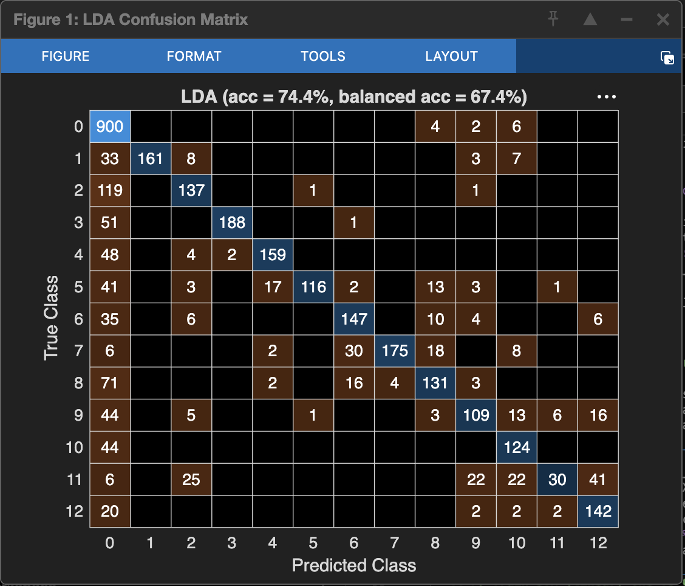
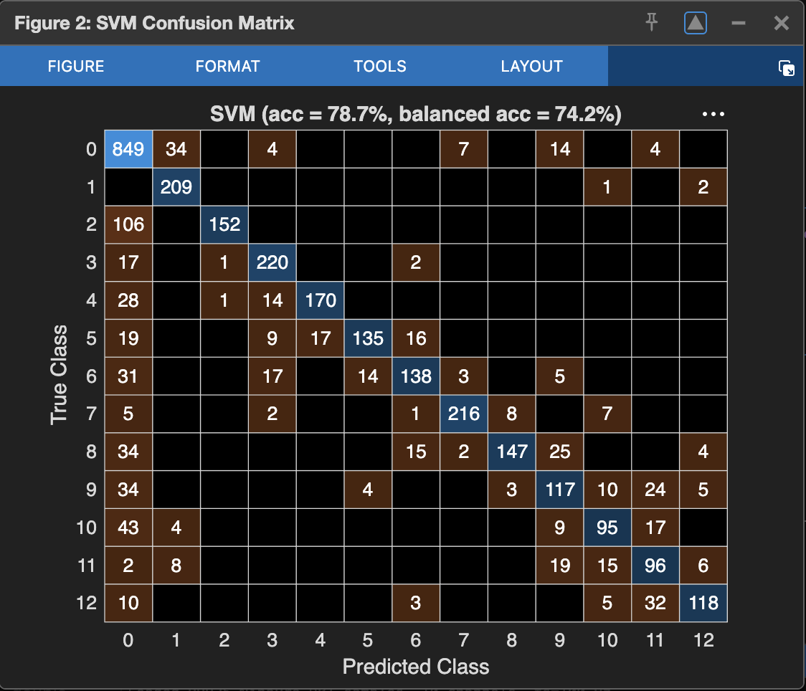

# EMG Gesture Classification

## Overview

This MATLAB pipeline uses RMS-processed NinaPro DB1 signals (10 channels,
100 Hz). It extracts window-level features and compares LDA and linear SVM
classifiers.

The DB1 electrodes apply RMS processing before recording. The pipeline does
not apply a raw-EMG 20–450 Hz band-pass or a 50 Hz notch filter.

## Files

- `main_train_pipeline.m` loads the converted dataset, creates a
  repetition-group holdout, trains classifiers, reports accuracy and
  balanced accuracy, and saves the LDA model.
- `convert_ninapro_csv_to_mat.m` converts the CSV and exports signal,
  labels, sampling rate, and repetition metadata.
- `restore_ninapro_csv.m` reconstructs the CSV from the repository's
  Git-LFS chunks when needed.
- `segment_windows.m` creates 200 ms windows at 50 ms steps and discards
  windows that cross repetition boundaries.
- `extract_features.m` computes MAV, RMS, waveform length, and slope sign
  changes (SSC) for each channel.
- `preprocess_emg.m` validates the DB1 sampling rate and leaves the
  preprocessed envelope unchanged.
- `generate_synthetic_emg.m` is a separate synthetic-data generator and is
  not used by the main pipeline.
- `simulink_function_block.m` contains an example MATLAB Function block
  for 100 Hz input.

## Run

1. Open MATLAB in this folder.
2. Run `convert_ninapro_csv_to_mat.m` to create `S1_A1_E1.mat`.
3. Run `main_train_pipeline.m`.
4. Review the printed accuracy, balanced accuracy, majority-class baseline,
   and confusion matrices. The script saves `trained_emg_model.mat`.

The pipeline processes a contiguous prefix of up to 100,000 samples and
holds out complete subject/exercise/repetition groups. It excludes windows
that cross group boundaries. This avoids splitting overlapping windows
from the same repetition across train and test, but it is not a
subject-independent evaluation. The confusion matrices below are from the
pilot run described here; earlier screenshots in the image folder are from
the previous evaluation procedure.

Pilot run on 99,925 samples: LDA accuracy **74.4%** and balanced accuracy
**67.4%**; linear SVM accuracy **78.7%** and balanced accuracy **74.2%**.
The majority-class baseline was **27.0%**. The holdout contained three
subject/exercise/repetition groups, but all samples were from the same
subject, so these results do not measure generalization to unseen users.
The reported LDA run used MATLAB's `pseudoLinear` discriminant type to
handle a predictor with zero within-class variance.

### Pilot-run confusion matrices

The required MATLAB toolbox is Statistics and Machine Learning Toolbox
(`fitcdiscr`, `fitcecoc`, `confusionmat`, `confusionchart`).

## Limitations

- Results use only a pilot subset, not the complete NinaPro DB1 dataset.
- Grouped holdout is by repetition, not by subject.
- The 200 ms window and 50 ms step have not been selected through a
  systematic parameter study.
- Embedded inference performance has not been benchmarked on target
  hardware.
- The Simulink block is an example for normal simulation. Its use of
  `coder.extrinsic` and `load` does not provide standalone embedded code
  generation.
